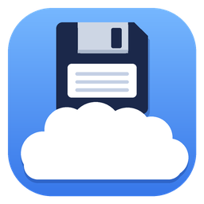

<p align="center">
  
</p>

<h1 align="center">SaveGameCloud</h1>

<p align="center">
  Lancez vos vieux jeux PC depuis SaveGameCloud : leurs sauvegardes sont synchronisées dans <b>votre</b> Google Drive.<br>
  Reprenez votre partie sur n'importe quel PC.
</p>

<p align="center">
  <a href="https://github.com/Er4m3d/savegamecloud/releases/latest/download/SaveGameCloud.exe"><b>⬇ Télécharger SaveGameCloud.exe</b></a>
  · <a href="https://er4m3d.github.io/savegamecloud/">Site</a>
  · <a href="https://er4m3d.github.io/savegamecloud/privacy.html">Confidentialité</a>
</p>

Ce document s'adresse à deux publics différents :

- **[Pour les joueurs](#pour-les-joueurs)** : télécharger l'appli, se connecter et jouer. Rien à configurer,
  aucune connaissance technique nécessaire.
- **[Pour les développeurs](#pour-les-développeurs)** : compiler le code, créer son propre identifiant Google et
  comprendre le fonctionnement interne. Si vous voulez seulement utiliser l'appli, vous n'avez pas besoin de cette partie.

---

# Pour les joueurs

## 1. Installer

1. [Téléchargez **SaveGameCloud.exe**](https://github.com/Er4m3d/savegamecloud/releases/latest/download/SaveGameCloud.exe).
   Il fonctionne sous Windows 10 ou 11 (64 bits).
2. Rangez-le où vous voulez (par exemple dans `Documents`), puis double-cliquez dessus. Il n'y a **rien à installer**.

> Si Windows affiche « Windows a protégé votre ordinateur », cliquez sur **Informations complémentaires**, puis sur
> **Exécuter quand même**. Cet avertissement apparaît parce que l'exe n'est pas signé numériquement.

## 2. Se connecter à Google

Cliquez sur **Se connecter avec Google**. Votre navigateur s'ouvre : choisissez votre compte et autorisez l'accès.
C'est tout, il n'y a rien d'autre à configurer.

- Vos sauvegardes vont dans **votre** Google Drive, dans un dossier `SaveGameCloud`.
- L'appli ne voit **que les fichiers qu'elle a créés elle-même**. Elle n'a pas accès au reste de votre Drive.
- La connexion est mémorisée : vous n'aurez pas à la refaire à chaque lancement.

## 3. Ajouter un jeu

1. Cliquez sur **＋ Ajouter un jeu**, puis choisissez l'exécutable du jeu (le `.exe` qui le lance).
2. Vérifiez le **nom du jeu**. C'est aussi le nom du dossier dans Google Drive.
3. Ajoutez les **fichiers et dossiers de sauvegarde** avec *Ajouter des fichiers…* ou *Ajouter un dossier…*.
4. Cliquez sur **Enregistrer**.

**Où se trouvent les sauvegardes d'un vieux jeu ?** Le plus souvent :

- dans le dossier du jeu, sous un nom comme `SAVE`, `Saves` ou dans des fichiers `*.sav` ;
- dans `Documents\My Games\…` ou dans `Saved Games` ;
- dans `%APPDATA%` ou `%LOCALAPPDATA%`. Pour un jeu installé dans `Program Files`, regardez aussi dans
  `%LOCALAPPDATA%\VirtualStore`.

Le site [PCGamingWiki](https://www.pcgamingwiki.com) indique l'emplacement exact pour la plupart des jeux.

> Choisissez le dossier des sauvegardes, pas le dossier entier du jeu : sinon, tout le jeu serait envoyé dans votre
> Drive à chaque partie. L'appli vous prévient si un élément dépasse 200 Mo ou 2 000 fichiers.

## 4. Jouer

Cliquez sur **▶ Jouer**, ou double-cliquez sur le jeu dans la liste.

1. **Avant la partie**, SaveGameCloud compare votre sauvegarde à celle de Google Drive :
   - si celle du **cloud est plus récente**, elle est téléchargée automatiquement ;
   - si celle de **ce PC est plus récente**, une fenêtre vous demande laquelle garder ;
   - si elles sont **identiques**, le jeu se lance directement.
2. **Le jeu se lance.** L'appli se réduit et attend que vous quittiez le jeu.
3. **À la fermeture du jeu**, votre sauvegarde est envoyée dans Google Drive.

**Raccourci bureau** : le bouton *Raccourci bureau* crée sur le bureau une icône qui lance le jeu avec la
synchronisation, sans passer par la fenêtre de SaveGameCloud.

## 5. Jouer sur plusieurs PC

Votre **liste de jeux est aussi sauvegardée dans Google Drive**, avec l'emplacement de leurs sauvegardes. Sur un autre
PC, installez SaveGameCloud et connectez-vous avec **le même compte Google** : tous vos jeux apparaissent, déjà configurés.

- Un jeu absent de ce PC est marqué **« Non installé sur ce PC »**. Installez-le, ou cliquez sur
  **Localiser l'exécutable…** s'il est installé ailleurs (par exemple sur `D:\` au lieu de `C:\`). L'appli retrouve
  ensuite ses sauvegardes au bon endroit, par rapport au dossier du jeu.
- Ajouter, modifier ou supprimer un jeu sur un PC est répercuté sur les autres à leur prochaine ouverture.
  Supprimer un jeu du launcher n'efface jamais ses fichiers, ni ses sauvegardes dans Google Drive.

## 6. Si quelque chose tourne mal

- **Copies de secours** : avant de remplacer vos fichiers par ceux du cloud, SaveGameCloud fait une copie des
  fichiers de ce PC. Le bouton *Sauvegardes de secours* ouvre le dossier qui les contient (les 10 dernières par jeu).
- **Fichiers supprimés du cloud** : ils partent dans la **corbeille de Google Drive**. Vous pouvez donc les récupérer.
- **Synchronisation manuelle** : les boutons *Envoyer vers le cloud* et *Récupérer depuis le cloud* forcent la
  synchronisation dans un sens ou dans l'autre.
- **Sans internet** : le jeu peut quand même se lancer. À la fin de la partie, l'appli vous demande si elle doit
  envoyer la sauvegarde. Elle ne remplace jamais en silence une sauvegarde du cloud qu'elle n'a pas pu vérifier.
- **Google Drive plein** : un message vous l'indique. Libérez de l'espace, puis cliquez sur *Envoyer vers le cloud*.

## 7. Limites

- Si un jeu passe par **Steam, GOG Galaxy** ou un autre lanceur déjà ouvert, SaveGameCloud ne peut pas savoir
  quand vous le quittez. Choisissez directement l'exécutable du jeu.
- Un fichier que vous déposez **à la main** dans le dossier Drive, depuis le site de Google Drive, est ignoré :
  l'appli ne voit que les fichiers qu'elle a envoyés elle-même.

## 8. Vos données et la désinstallation

- **Sur votre PC**, SaveGameCloud range ses réglages dans `%APPDATA%\SaveGameCloud` : la liste des jeux, la
  connexion Google et les copies de secours.
- **Dans Google Drive**, vos sauvegardes sont dans le dossier `SaveGameCloud`, avec votre liste de jeux
  (`.savegamecloud-library.json`).
- **Le développeur ne reçoit aucune de vos données.** Il n'y a aucun serveur intermédiaire. Pour les détails,
  voir les [règles de confidentialité](https://er4m3d.github.io/savegamecloud/privacy.html).

**Pour désinstaller** :

1. cliquez sur **Se déconnecter** dans l'appli ;
2. supprimez `SaveGameCloud.exe` et le dossier `%APPDATA%\SaveGameCloud` ;
3. si vous voulez aussi effacer vos sauvegardes du cloud, supprimez le dossier `SaveGameCloud` de votre Google Drive.

Vous pouvez aussi retirer l'accès de l'appli depuis [myaccount.google.com/permissions](https://myaccount.google.com/permissions).

**Une question ?** Écrivez à [savegamecloud-support@googlegroups.com](mailto:savegamecloud-support@googlegroups.com).

---

# Pour les développeurs

Cette partie sert uniquement à compiler votre propre version de SaveGameCloud. Pour simplement utiliser l'appli,
voir [Pour les joueurs](#pour-les-joueurs).

## Prérequis

- Windows 10 ou 11
- [SDK .NET 10](https://dotnet.microsoft.com/download)
- Python 3 avec Pillow, uniquement pour régénérer l'icône

## Compiler et tester

```bash
dotnet test
```

```bash
dotnet publish src/SaveGameCloud -c Release -o publish
```

La publication produit un `publish\SaveGameCloud.exe` autonome : un seul fichier, qui ne nécessite pas d'installer .NET.

## Identifiant Google (OAuth)

L'exe officiel contient l'identifiant OAuth du projet SaveGameCloud. Le fichier `client_secret.json` correspondant
n'est **pas** dans ce dépôt : pour votre propre version, vous devez créer votre propre identifiant. Comptez environ 5 minutes.

1. Ouvrez la [console Google Cloud](https://console.cloud.google.com/) et créez un projet.
2. **API et services → Bibliothèque** : activez **Google Drive API**.
3. **Google Auth Platform → Branding** : type d'utilisateur **Externe**, nom de l'application et e-mail d'assistance.
   Dans **Audience**, ajoutez votre adresse dans **Utilisateurs test**.
4. **Clients → Créer un client** : choisissez le type **Application de bureau**, puis téléchargez le JSON.
5. Enregistrez-le sous `src/SaveGameCloud.Core/client_secret.json`, puis recompilez.
   - Ce fichier est intégré à l'exe comme ressource et reste exclu de git par `.gitignore`.
   - Sans lui, la compilation affiche un avertissement, et l'appli propose d'importer un identifiant au premier lancement.
6. Pour distribuer l'appli, passez-la **en production** (Audience → « Publier l'application »). Google demande pour
   cela une page d'accueil, des règles de confidentialité publiques et un domaine autorisé. Le dossier `docs/` de ce
   dépôt, publié avec GitHub Pages, remplit ce rôle.
   - En mode test, seuls 100 utilisateurs test au maximum peuvent se connecter, et ils doivent se reconnecter tous les 7 jours.
   - La portée `drive.file` n'est pas sensible : pas de validation Google, tant que vous n'ajoutez pas de logo.

Un `client_secret.json` posé à côté de l'exe ou dans `%APPDATA%\SaveGameCloud` est **prioritaire** sur celui
intégré : on peut ainsi changer d'identifiant sans recompiler.

> L'identifiant d'une application de bureau n'est pas un vrai secret : Google prévoit qu'il soit livré dans l'exe.
> En cas d'abus, créez-en un nouveau, supprimez l'ancien dans la console et publiez une nouvelle version.

## Structure du code

| Dossier | Contenu |
|---|---|
| `src/SaveGameCloud.Core/Sync` | Analyse local/cloud, téléchargement, envoi (`SyncEngine`), copies de secours, garde-fous de taille (`SizeGuard`) |
| `src/SaveGameCloud.Core/Cloud` | Connexion Google (`GoogleAuthService`) et stockage Drive (`GoogleDriveStorage`) |
| `src/SaveGameCloud.Core/Launch` | Lancement du jeu et attente de sa fermeture (`GameLauncher`), déroulé complet d'une partie (`LaunchCoordinator`) |
| `src/SaveGameCloud.Core/Infrastructure` | Configuration, chemins portables (`PathTokens`), journal |
| `src/SaveGameCloud` | Interface WPF |
| `tests/SaveGameCloud.Tests` | Tests, avec un faux Google Drive en mémoire |
| `docs/` | Site GitHub Pages : accueil et règles de confidentialité |
| `tools/make_icon.py` | Génère l'icône et le favicon |

## Fonctionnement interne

**Comparaison local / cloud**
- Les fichiers sont d'abord comparés par **empreinte MD5**. S'ils sont tous identiques, rien n'est transféré.
- Sinon, on compare la date de modification la plus récente **parmi les fichiers qui diffèrent**, côté local et
  côté cloud, avec une marge de 2 s :
  - cloud plus récent → téléchargement automatique ;
  - local plus récent ou dates équivalentes → l'utilisateur choisit.
- La date de chaque fichier est conservée dans Drive (`modifiedTime`) et restaurée au téléchargement.

**Miroir**
- Un téléchargement fait du local un miroir du cloud. Les fichiers locaux remplacés ou supprimés sont d'abord
  copiés dans `Backups\`.
- Un envoi fait du cloud un miroir du local. Les fichiers retirés du cloud sont mis à la corbeille Drive.
- Seuls les fichiers qui correspondent à un élément configuré sont gérés. Les autres fichiers du dossier Drive
  ne sont jamais touchés.

**Attente de la fermeture du jeu**
- Le jeu est lancé suspendu, placé dans un *Job Object* Windows, puis relancé. SaveGameCloud attend ensuite que
  le processus principal **et** tous ses descendants soient terminés.
- Si le jeu exige les droits administrateur, il est relancé via UAC, et l'appli surveille alors seulement le processus principal.

**Chemins portables**
- Les chemins sont enregistrés avec des jetons qui s'adaptent à chaque PC : `{GameDir}` (dossier de l'exécutable),
  `{Documents}`, `{SavedGames}`, `{AppData}`, `{LocalAppData}`, `{LocalLow}`, `{UserProfile}`, `{ProgramData}`,
  `{PublicDocuments}`, `{ProgramFiles}`, `{ProgramFilesX86}`.

**Garde-fous de taille**
- La taille n'est pas plafonnée. En revanche, une sauvegarde est jugée volumineuse à partir de **200 Mo ou
  2 000 fichiers** (seuils dans `SizeGuard.cs`) :
  - un avertissement s'affiche à l'ajout de l'élément ;
  - avant un envoi, une confirmation est demandée si la sauvegarde n'a jamais été synchronisée à cette taille
    (premier envoi, ou taille plus que doublée).
- L'erreur Drive `storageQuotaExceeded` est traduite en message clair, sans proposer de réessayer.

**Bibliothèque partagée entre PC** (`Core/Library`)
- La définition des jeux (identifiant, nom, arguments, éléments à synchroniser, exe de référence) est stockée dans
  `SaveGameCloud/.savegamecloud-library.json` sur Drive.
- Elle est fusionnée avec `config.json` à la connexion, puis après chaque ajout, modification ou retrait
  (`LibraryMerger`). Pour chaque jeu, la définition la plus récente (`UpdatedUtc`) gagne.
- Ce qui est propre à chaque PC n'est jamais écrasé : chemin réel de l'exe, état de synchro, dernière partie.
- Les retraits sont propagés grâce à des marqueurs datés (`RemovedGames`).
- Un jeu créé localement avec le même nom qu'un jeu de la bibliothèque y est rattaché. Son ancien identifiant est
  conservé dans `AliasIds`, pour que les raccourcis existants continuent de fonctionner.
- Un jeu dont l'exe est introuvable est affiché « Non installé ». Si l'exe de référence apparaît plus tard sur
  ce PC, il est adopté automatiquement.

**Lancement depuis un raccourci**
- La commande `SaveGameCloud.exe --launch <id>` synchronise, lance le jeu puis se ferme.
- Un sémaphore nommé empêche de lancer deux fois le même jeu.
- La configuration est relue et écrite sous un mutex, car plusieurs instances de l'appli peuvent tourner en même temps.

**Fichiers locaux** (`%APPDATA%\SaveGameCloud`)

| Élément | Rôle |
|---|---|
| `config.json` | Liste des jeux (copie locale de la bibliothèque), état de synchro propre à ce PC |
| `client_secret.json` | Identifiant OAuth importé (facultatif, prioritaire sur celui intégré) |
| `google-token\` | Jeton de connexion Google, supprimé à la déconnexion |
| `Backups\<jeu>\<date>\` | Copies de secours faites avant un téléchargement |
| `logs\` | Journal mensuel |

La variable d'environnement `SAVEGAMECLOUD_DATA_DIR` permet d'utiliser un autre dossier de données, pour les tests
ou en mode portable.

## Icône

```bash
python tools/make_icon.py
```

Le script régénère `src/SaveGameCloud/Assets/app.ico` (16 à 256 px), `app-256.png`, ainsi que `docs/icon-256.png`
et `docs/favicon.ico`.

## Publier une version

1. Incrémentez `<Version>` dans `src/SaveGameCloud/SaveGameCloud.csproj`.
2. Lancez `dotnet test`, puis `dotnet publish src/SaveGameCloud -c Release -o publish`, avec le
   `client_secret.json` en place.
3. Créez une release GitHub (tag `vX.Y.Z`) et joignez-y `publish\SaveGameCloud.exe`. Le lien de téléchargement
   `releases/latest/download/SaveGameCloud.exe` pointe automatiquement vers la dernière version.

## Licence

[MIT](LICENSE)
